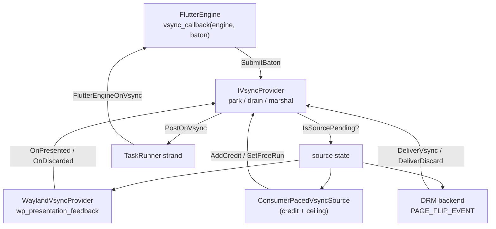

# vsync/

The backend-spanning vsync baton machinery. Flutter hands the embedder an
opaque `baton` via its `vsync_callback` and expects exactly one
`FlutterEngineOnVsync(baton)` back, marshaled onto the platform task runner.
The park/drain/marshal dance is identical across backends; only the *source*
of the vblank signal differs (a Wayland `wp_presentation.presented` event, a
DRM `PAGE_FLIP_EVENT`, or a software page-flip). This directory holds the
shared baton class and the per-source providers.

---

## Features

| Capability | Status | Toggle / scope |
|---|---|---|
| `IVsyncProvider` — baton park/drain/marshal machinery | ✓ | Always compiled |
| Cold-start safety (parked baton survives before runner is wired) | ✓ | Always |
| Frame parking (suspend production, keep engine warm) | ✓ | Always |
| Discard + parked-baton delivery (wall-clock fallback) | ✓ | Always |
| Vblank pacing: at most one baton per refresh, on the vblank | ✓ | On for the DRM backends; `IVI_VSYNC_PACE=0` turns it off |
| Wayland grid pacing: frames on the vblanks, up to 2 commits in flight | ✓ | On by default; `IVI_WL_VSYNC_GRID=0` turns it off; `IVI_WL_VSYNC_GRID_DEPTH=1` allows 1 |
| Wayland start window: a frame asked for just after the vblank starts at once | ✓ | 2 ms on the grid; `IVI_WL_VSYNC_START_WINDOW_MS` sets it (0 to 8, 0 off) |
| Wayland latch lead: when the window samples platform views, before the vblank | ✓ | On by default; `IVI_WL_LATCH_LEAD=0` reports 0 |
| Per-present cadence profiling (window + session summary) | ✓ | `IVI_VSYNC_PROFILE` |
| `WaylandVsyncProvider` — `wp_presentation` → `OnVsync` | ✓ | `-DBUILD_BACKEND_WAYLAND_EGL=ON` or `-DBUILD_BACKEND_WAYLAND_VULKAN=ON` |
| `ConsumerPacedVsyncSource` — backpressure / credit-based pacing | ✓ | Always compiled (used by `headless-egl`) |
| Motion-to-photon hookup on `OnPresented` | ✓ | `IVI_M2P_PROFILE` (or `IVI_PROFILE`) |

---

## Architecture

The Flutter engine's vsync callback is a trampoline — it parks the baton in
the provider and returns. The provider then decides when to hand it back:

- **`IsSourcePending()` true** (a present is already in flight) → wait for the
  source's completion event.
- **`IsSourcePending()` false** (idle pipeline) → drain inline, on the wall
  clock, so Flutter is never stalled. When the provider paces to the vblank
  and a baton already went out this refresh, the request waits for the next
  vblank instead; see [Pacing to the vblank](#pacing-to-the-vblank).

`DeliverVsync(frame_start_ns)` / `DeliverDiscard()` are called by the source
when a frame is actually presented or dropped. `PostOnVsync` posts
`FlutterEngineOnVsync` onto the platform runner — Flutter rejects it from any
other thread.

### Module responsibilities

- **`IVsyncProvider`** ([ivsync_provider.{h,cc}](ivsync_provider.h)) — the
  baton machinery. State is lock-free atomics; the platform-runner strand is
  the only place `FlutterEngineOnVsync` is called. Sources can either subclass
  (override `IsSourcePending` / `PeriodNs`) or drive the composition path
  (`SetSourcePending` / `SetPeriodNs`).
- **`WaylandVsyncProvider`**
  ([wayland_vsync_provider.{h,cc}](wayland_vsync_provider.h)) — owns
  `wp_presentation`, turns its per-commit `wp_presentation_feedback.presented`
  events into `OnVsync` calls. Presentation feedback corresponds to the
  `wl_surface.commit` made by either the EGL (`eglSwapBuffers`) or Vulkan
  rendering path. One `WpFeedbackHandler` per commit; in-flight feedback
  objects are destroyed race-safely with `Stop()`.
- **`ConsumerPacedVsyncSource`**
  ([consumer_paced_vsync.{h,cc}](consumer_paced_vsync.h)) — drives vsync from
  downstream consumer completion instead of a wall clock. A **credit** is one
  free slot in the producer's pipeline; delivering a baton commits a slot,
  `AddCredit` returns one. An optional `min_period_ns` caps the rate so a fast
  consumer cannot free-run the engine. Used today by the headless-EGL GLES
  encoder; a Vulkan encoder can drive it unchanged.

### Threading model

- **Source thread** (Wayland event thread, DRM page-flip reader thread,
  encoder consumer thread) — calls `DeliverVsync` / `DeliverDiscard` /
  `AddCredit`.
- **Platform task-runner thread** — the only place `FlutterEngineOnVsync` is
  invoked. `PostOnVsync` posts there via the runner's strand.
- **Any thread** — `SubmitBaton`, `AddCredit`, `SetFreeRun`, `SetParked`.
  State is lock-free atomics; `SubmitBaton` and `SetParked` update atomics on
  the caller's thread, and only the callback delivery (`PostOnVsync`) is
  posted. `ConsumerPacedVsyncSource` additionally posts its mutable
  scheduling state (credits, ceiling timer) to the strand.

---

## Build steps

### Configure + build

`IVsyncProvider` and `ConsumerPacedVsyncSource` are always compiled. The
Wayland provider is gated:

| Source | Gate |
|--------|------|
| `vsync/ivsync_provider.cc`, `vsync/consumer_paced_vsync.cc` | Always |
| `vsync/wayland_vsync_provider.cc` | `BUILD_BACKEND_WAYLAND_EGL` or `BUILD_BACKEND_WAYLAND_VULKAN` |

### Dependencies

- **wayland-cxx-scanner** — generated `presentation_time::client` bindings.
- **Asio** — `steady_timer` for the ceiling timer in
  `ConsumerPacedVsyncSource`.

---

## Running

### Vsync sources and completion signals

| Source | Completion / pacing signal |
|--------|----------------------------|
| `WaylandVsyncProvider` | `OnPresented` fires when the compositor's `wp_presentation_feedback.presented` event arrives. |
| DRM page-flip | `DeliverVsync` is called when the kernel delivers `PAGE_FLIP_EVENT` on the card fd. |
| Software page-flip | `DeliverVsync` is called when the sink's page-flip completes. |
| `ConsumerPacedVsyncSource` | A parked baton becomes deliverable when the consumer releases a frame slot (`AddCredit`); no present is recorded. |

### Pacing to the vblank

Nothing is in flight from the moment a baton goes out until that frame
commits, so an unpaced provider answers every request made in that window at
once. A ticker that asks again as soon as it is answered gets a burst of empty
frames right after each vblank, and a frame started before the one ahead of it
has presented waits a whole refresh behind it.

`SetPaceToVblank(true)` hands out at most one baton per refresh:

- A request made after a baton already went out this refresh waits for the
  next vblank, counted from the last presentation (`DeliverVsync`) and the
  period. It is delivered from a timer on the runner's `io_context`, and the
  vblank is its frame start.
- A flip still hands the baton back at once, unless `SetPaceFlips(true)`: then
  a presentation that arrives after a baton already went out this refresh
  leaves the baton for the next vblank.
- A request after a refresh with no baton out is still answered at once, so an
  idle display wakes as quickly as before. With `SetPaceKeepPhase(true)` that
  needs a whole refresh with no baton: a request in the refresh after a
  hand-out waits for the next vblank, so frames asked for mid-refresh (a
  platform view submitting) still start on the vblank. `SetPaceStartWindow`
  lets one made just after that vblank start at once (see the Wayland grid
  section).

Each deferred delivery waits on its own timer, owned by its handler, so no
timer outlives the runner's `io_context`. `SetEngine()` binds the waits to the
provider and `Stop()` lets go of them, so the provider can outlive a runner
and be wired to the next one.

The DRM backends (`drm-kms-vulkan`, `drm-kms-egl`) turn it on.
`IVI_VSYNC_PACE=0` turns it off. `SetPacingClockForTest` replaces the clock and
the timer, so a test sets the time and fires the deferred delivery itself (see
`test/unit_test/vsync_pace-test`).

### Wayland grid pacing

Without it, `WaylandVsyncProvider` holds the baton while any commit waits for
its presentation, so the frame rate follows the host's latency. One commit
shown a refresh late starts the next frame a refresh late. The host's repaint
loop goes idle in the gap and restarts a refresh late again, and the window
settles at half rate. On a vendor compositor this showed as runs locked at
30 fps with every commit shown two vblanks after it.

With grid pacing (`SetGridPacing`, on unless `IVI_WL_VSYNC_GRID=0`), the
provider paces to the vblank with `SetPaceFlips` and `SetPaceKeepPhase` too.
Only a full pipeline holds the baton for a presentation: `kGridInFlight`, 2
commits waiting to be shown, or 1 with `IVI_WL_VSYNC_GRID_DEPTH=1`. Frames start
on the vblanks the presentations reveal, at most one per refresh, so a late
commit costs one refresh, not every one after it. A discard is paced the same
way as a presentation. Grid pacing starts with the first presentation that
reports a refresh period; a compositor that reports 0 (unknown or variable)
keeps presentation-paced frames.

Keep-phase holds a request made mid-refresh for the next vblank. One made just
after the vblank, with no frame started in that refresh yet, starts at once
instead: a platform view that submits a little after the vblank, with Flutter
idle, would otherwise wait a whole refresh, while a frame started that early
still commits before the host's deadline. Its frame start is that vblank, as
for a frame started on it. The window is 2 ms (`SetStartWindow`,
`IVI_WL_VSYNC_START_WINDOW_MS`, 0 to 8, 0 turns it off), and at most half the
period counts. It starts no second frame in a refresh that already has one.

With grid pacing on, the motion-to-photon cutoff stamped on a commit's
feedback is approximate: the next baton can go out before that frame commits.

### Wayland latch lead

A Wayland backend composites platform views into the window's frame on the
rasterizer thread, then commits. A view's newest frame is taken at that
moment, not at a repaint window before the vblank as on DRM. Each backend
calls `NoteLatch()` when it samples a view's frame. The provider turns that
into a lead before the next vblank: the period less the take's phase after the
last presentation. It keeps a decaying maximum, which widens at once for an
earlier take and eases back over about a second. The backend reports it as
`PlatformViewLatchLeadNs()`, which the platform-view host passes on as
`IhsPvCapabilities::latch_lead_ns`. It is 0 until a take has been seen after a
presentation, and `IVI_WL_LATCH_LEAD=0` keeps it at 0. A change of refresh
period starts it over. Views on one display share the provider, so takes from
several rasterizer threads are serialized.

### Vsync profiling

`IVI_VSYNC_PROFILE=1` enables per-present cadence diagnostics. A window
summary is logged every 60 presents and a session summary on `Stop()`. The
label tags the log lines (e.g. `[DrmVsync]`, `[WaylandVsync]`,
`[SoftwareVsync]`).

### Motion-to-photon

When `IVI_M2P_PROFILE=1` (or `IVI_PROFILE=1`), `OnPresented` feeds the
motion-to-photon profiler with the real present timestamp. The cutoff
(`frame_start_time`) is stamped at baton delivery and read back by the
profiler to attribute inputs to the frame that consumed them.

### Parking

`SetParked(true)` stops frame production without tearing down the engine.
The baton is simply not handed back — Flutter asked for a vsync and gets no
answer, so it builds no frame and the whole pipeline (UI thread, rasterizer,
GPU, scanout) goes quiet. This is what a view whose display was unplugged
should do. `SetParked(false)` unparks and delivers any parked baton.

---

## Diagnostics/Debug

- **Cold-start leak** — a baton parked before the platform runner is wired is
  *left parked* (not exchanged out and dropped); `SetEngine` drains it via a
  kick latch once the runner arrives. This is the documented fix for #210.
- **Discarded frames** — `DeliverDiscard()` counts a discard and hands the
  baton back on the wall clock so Flutter keeps scheduling. Discards are
  profiled when `IVI_VSYNC_PROFILE` is set.
- **Parked-baton kick** — `DeliverParkedBaton()` is for control-flow kicks where
  no source event will fire to return the baton (a VT resume, a post-modeset
  drain). Unlike `DeliverDiscard` it records no profile discard.
- **Consumer-paced free-run** — `SetFreeRun(true)` paces on the ceiling alone,
  ignoring credits, for when no consumer is attached. Headless EGL enables it
  from the `IVI_HEADLESS_FREERUN` env var; headless Vulkan flips it on and off
  as export consumers attach and detach. Turning it back off resets the credit
  count to the full pipeline depth.

---

## Known limitations

- `ConsumerPacedVsyncSource::SetFreeRun` resets the credit count to the full
  pipeline depth. A consumer that hitched and re-established the pool must
  start with that invariant.
- `WaylandVsyncProvider` leaves vsync unset when `wp_presentation` is not
  usable (unbound, or its announced clock is not `CLOCK_MONOTONIC`); Flutter
  then falls back to its wall-clock scheduler.

---

## References

- [`shell/vsync/ivsync_provider.h`](ivsync_provider.h) — `IVsyncProvider`
- [`shell/vsync/wayland_vsync_provider.h`](wayland_vsync_provider.h) —
  `WaylandVsyncProvider`
- [`shell/vsync/consumer_paced_vsync.h`](consumer_paced_vsync.h) —
  `ConsumerPacedVsyncSource`
- [`shell/profiling/README.md`](../profiling/README.md) —
  `FrameProfile` + `MotionToPhoton`
- [`shell/task_runner.h`](../task_runner.h) — the platform runner that
  `FlutterEngineOnVsync` is marshaled onto
